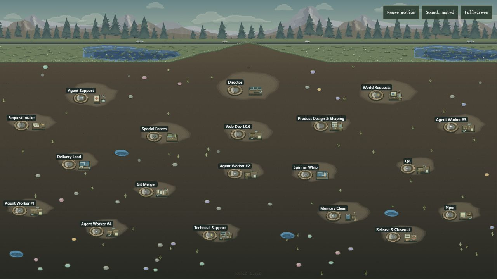

# ALife Worlds

ALife Worlds is a Codex plugin for making interactive worlds from pictures, your own artwork, or a few words. Build a place for a story or a small game, or give the agents in your project a place to work. You can start with the default world, bring an existing project, or choose which characters appear in the world.

[Visit ALife Worlds](https://alifeworlds.com/) · [See the starting prompt](https://alifeworlds.com/how-it-works) · [Install in Codex](#install-in-codex-on-windows) · [Create your private world](#create-your-private-world) · [Download the release](#download-the-release-candidate) · [Report a bug or suggest an idea](https://github.com/ALifeWorlds/alife-worlds-releases/issues/new/choose)


## A world you can see

[](https://alifeworlds.com/world/view)

*The default world gives your team a place to work. [Explore the public demo](https://alifeworlds.com/world/view), or start with your own setting.*

<table>
<tr><td align="center" width="50%"><br><strong>A cozy home for your characters</strong></td><td align="center" width="50%"><br><strong>A story, a scene, or a world of your own</strong></td></tr>
</table>

*Art concepts from the ALife Worlds website. Bring references or describe the world you want; the ant world is one starting point.*

## What you can do

- **Make the world yours.** Start directly with your own world. Change its art, characters, layout, animation, sound and interactions; ant-world visuals are optional and remain available as a separate backup. Describe a setting or supply reference artwork in Codex. Start with a scene you can explore, then ask for changes to its appearance and interactions.
- **See when your team needs you.** In the default world, each connected agent has a room. When an agent asks for input, its ant shows that state. Open the activity list to see the latest recorded work.
- **Follow a sprint.** Check the goal, next action, blockers, and outstanding QA on a task card. Expand a sprint to see the tasks behind its progress.
- **Reuse rules across worlds.** At the bottom of the sprint section, open **Rules** to copy or export plugin and world rules. Review them in the destination project before importing them.

Your world starts in your local project. You can also pair it with an owner-private Site to view that project’s world and agents on the web. The [public ALife Worlds website](https://alifeworlds.com/) is open to everyone. Your private dashboard has its own address and access list.

Created by **[Itzel Juarez](https://github.com/ItzelJuarez)**. Official plugin releases are published by **[ALife Worlds](https://github.com/ALifeWorlds)**.

## Download the release candidate

**[Download ALife Worlds v0.4.16-rc (.zip)](https://github.com/ALifeWorlds/alife-worlds-releases/releases/download/v0.4.16-rc/alife-worlds-0.4.16.zip)** · [Release notes](https://github.com/ALifeWorlds/alife-worlds-releases/releases/tag/v0.4.16-rc) · [SHA-256 checksum](packages/SHA256SUMS)

The release tag is **v0.4.16-rc**. The plugin inside the ZIP reports **0.4.16**.

The download above is the installable plugin ZIP. The [release guide](RELEASE.md) lists the changes in this candidate.

## Install in Codex on Windows

Already installed? Go to [Create your private world](#create-your-private-world).

### 1. Install with PowerShell

Start here. This installs the plugin before you create a world.

You need [Node.js 20 or newer](https://nodejs.org/en/download) and [Codex CLI](https://developers.openai.com/codex/cli/). To use the app steps below, install [Codex desktop](https://developers.openai.com/codex/app/) too. Use the same Windows account and Codex profile throughout.

1. Open the Windows Start menu.
2. Search for **PowerShell** and open it.
3. Expand **Show the PowerShell install commands** below.
4. Copy the whole box, paste it into PowerShell, and press Enter.
5. Wait for it to finish installing ALife Worlds.

<details>
<summary>Show the PowerShell install commands</summary>

```powershell
$ErrorActionPreference = 'Stop'
$release = Join-Path $env:LOCALAPPDATA 'ALifeWorlds\releases\v0.4.16-rc'
$plugin = Join-Path $release 'plugins\alife-worlds'
$catalog = Join-Path $release '.agents\plugins'
if (Test-Path -LiteralPath $release) { throw "The release folder already exists: $release. Use a new empty folder or register the existing installation." }
New-Item -ItemType Directory -Path $plugin, $catalog | Out-Null

$zip = Join-Path $release 'alife-worlds-0.4.16.zip'
$url = 'https://github.com/ALifeWorlds/alife-worlds-releases/releases/download/v0.4.16-rc/alife-worlds-0.4.16.zip'
Invoke-WebRequest -UseBasicParsing -Uri $url -OutFile $zip
$expected = '5d922adfbfc8393e381c0e4c1406e5f17e3ce2e87f8593440c59a5d350d05ac5'
if ((Get-FileHash -LiteralPath $zip -Algorithm SHA256).Hash -ne $expected) { throw 'Checksum mismatch. Stop here.' }
Expand-Archive -LiteralPath $zip -DestinationPath $plugin

$entry = '{"name":"alife-worlds-releases","plugins":[{"name":"alife-worlds","source":{"source":"local","path":"./plugins/alife-worlds"},"policy":{"installation":"AVAILABLE","authentication":"ON_INSTALL"},"category":"Productivity"}]}'
[IO.File]::WriteAllText((Join-Path $catalog 'marketplace.json'), $entry, [Text.UTF8Encoding]::new($false))
codex plugin marketplace add "$release"
if ($LASTEXITCODE -ne 0) { throw 'Catalog registration failed.' }
codex plugin add alife-worlds@alife-worlds-releases
if ($LASTEXITCODE -ne 0) { throw "Plugin installation failed." }
```

Keep the folder these commands create. Codex uses it to find the plugin.

</details>

If PowerShell says the release folder already exists, check **Codex → Plugins** first. If the download was interrupted, keep that folder and use a new folder name on the `$release` line before trying again.

After PowerShell finishes, choose how to create your world below.

If you use Codex desktop, open **Plugins** in the sidebar and watch for **ALife Worlds** to appear as installed and turned on. If it hasn’t appeared yet, close and reopen Codex using the same profile.

<details>
<summary>Other ways to finish installing</summary>

If the download step finished but you still need to install the plugin, use either option.

**Through the Codex app**

1. Open the Codex desktop app.
2. In the message box, type **`/alife`**.
3. Select **ALife Worlds → create-world** (`$alife-worlds:create-world`) from the results.
4. Choose **Install** if Codex asks.
5. Check **Plugins** in the sidebar.

**Through the Codex CLI**

In PowerShell, run this command.

```powershell
codex plugin add alife-worlds@alife-worlds-releases
```

Wait for it to finish. If you use the desktop app, look for **ALife Worlds** under **Plugins**.

</details>

## Create your private world

Allow about **20–40 minutes** when your world needs new artwork. You can start with your own custom world and keep the default world as a backup.

### 1. Open your project

Choose a new empty folder or the project folder you already use.

- **Codex app:** open that folder as a project, then start a chat there. If asked to trust the folder, check its name first.
- **Codex CLI:** open PowerShell in that folder, run `codex`, then use its project chat.

The same world request is used in either place. Setup needs Codex’s project and chat tools; if your CLI does not provide them, continue that project’s setup in the desktop app.

### 2. Make one starting prompt

1. Open [Create your world on the ALife Worlds website](https://alifeworlds.com/how-it-works#start).
2. Choose **New project** or **Existing project**.
3. Choose **Default world**, **Describe a world**, or **Use my references**.
4. Choose who appears on screen: **Dot + agents**, **Dot only**, or **Agents only**.
5. In your Codex project chat, type **`/alife`** and select **ALife Worlds → create-world** (`$alife-worlds:create-world`).
6. Click **Copy world prompt** on the website, paste your world request into that chat, and send it. For your first request, keep the selected create-world plugin attached. You do not need to type the website’s /Alife worlds starter line again.

You can also start the same message directly with **`$alife-worlds:create-world`**, followed by your world request. The plugin file location on each computer may be different.

For your own artwork, the prompt says to use the references you will upload. Add everything in one folder and give Codex its path, or attach files separately in the same chat. You do not need to make a document. Include your Dot’s avatar picture if Codex cannot access it.

The character options control who appears in the world. They do not remove existing chats or change settings. The standard plugin may still use its three world-building roles behind the scenes. Automatic Dot/avatar access depends on the host and is not assumed.

<details>
<summary>Prefer to write the request yourself?</summary>

Type `/alife` and select **ALife Worlds → create-world**, or begin directly with `$alife-worlds:create-world`. Then describe your project, scene, references and characters. For example:

> $alife-worlds:create-world
>
> Create an owner-private world for this project using the references I will upload in a folder or as separate files. Make my custom scene the one that opens and keep the default world as a backup. Show Dot + agents on screen. Reuse suitable existing agents and preserve their work, settings and privacy. If my Dot’s avatar is unavailable, ask for its picture before using a substitute.

You can change the character line to **Dot only** or **Agents only**.

</details>

Have an exported ALife world? Paste its complete `/import` content in the destination project chat and review the suggested changes.

### 3. Follow the setup

Keep the chat open and check for approvals. If another setup chat needs approval, open it and read the request before allowing it. Setup may save recovery progress in a folder named `.alife-project-operations` next to your project.

When setup is ready, open the world and check the project name and represented agents. To return later, ask the same project chat to open its existing ALife World.

To plan what to build, use the website’s [three-step goal and sprint planner](https://alifeworlds.com/how-it-works#sprints). Its visual example changes only in your browser; it does not change your real project.

## Open your world on a private website

After your world works in Codex, you can give it its own private web address.

1. Turn on the **Sites** plugin in Codex.
2. In the same project chat, send the message below.
3. Follow the sign-in and connection steps Codex shows.
4. Open the new link and sign in with the account that owns the Site.
5. Open that link in a private browser window while signed out. It should ask you to sign in or deny access.

> Create a private website for this world. Give access only to my account and connect only this project.

Keep your connection keys and private Site link out of public GitHub issues.

## Backups and liability

Before using the plugin on important work or approving a cleanup or deletion, save open files and make a backup you can restore. Include untracked files and any local world data you want to keep. Store private backups outside the project folder.

ALife Worlds is provided as is, without warranty. To the extent permitted by applicable law, the MIT License limits the liability of its authors and copyright holders, including original creator Itzel Juarez, for claims arising from use of the software. Examples include lost work, accidentally deleted projects, overwritten or corrupted files, and recovery costs. [License and explanatory note](LICENSE)

## Help improve the plugin

[Report a bug or suggest a change](https://github.com/ALifeWorlds/alife-worlds-releases/issues/new/choose). For a bug, include the release version, what you expected, what happened, and steps we can try in a sample world. For an idea, describe the change and who it would help. Please keep private Site links, pairing credentials, and chat logs out of public reports.

Read the [contribution guide](CONTRIBUTING.md) for how suggestions are reviewed. To report a sensitive issue, follow the [security reporting guide](SECURITY.md).

The software uses the [MIT license](LICENSE). Bundled fonts, audio, and artwork have their own [notices and credits](THIRD_PARTY_NOTICES.md).
